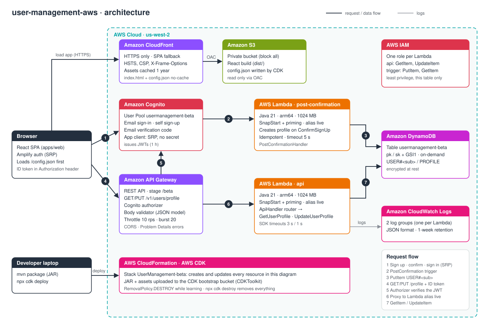

# user-management-aws

I'm learning React, AWS CDK, Java Lambda and DynamoDB. Explain what you do, go step by step.
Claude does not modify code: Claude explains, I make the changes myself.

## Stack
- infra/: AWS CDK (TypeScript). Stacks UserManagement-beta and UserManagement-prod
- services/user-api/: Java Lambda (Maven, compile with release 21; local JDK is 27)
- apps/web/: React 19 + Vite + TypeScript SPA, Amplify auth library (hosted on S3 + CloudFront)
- platform/: CDK pipeline (next); docs/: architecture notes

## Architecture

Source: [docs/architecture.svg](docs/architecture.svg). Everything shown is deployed (Phases 1 + 2).
History of what was built: [docs/WORKLOG.md](docs/WORKLOG.md).

## Decisions
- Build order: infra → backend → frontend
- One AWS account for now (456423665721, us-west-2); separate beta/prod accounts later via AWS Organizations
- AWS account comes from env var USER_MGMT_ACCOUNT (set in ~/.zshrc; validated as 12 digits in environments.ts). Pipeline will need it too.
- Config pattern: infra/config/types.ts + environments.ts (stage, env, retainData, pointInTimeRecovery, lambda, api, web.allowedOrigins)
- DynamoDB single-table design: table `usermanagement-${stage}`, keys pk/sk, GSI1 (gsi1pk/gsi1sk), PAY_PER_REQUEST
- No VPC (DynamoDB is reached over IAM + HTTPS)
- Everything destroyable while learning (RemovalPolicy.DESTROY, retainData false)
- Tags: Project, Developer, ManagedBy, Stage
- API design follows my Evently project (bappi2/evently7, Users module), adapted for Cognito:
  - Registration = Cognito SignUp + ConfirmSignUp (email code); NO /v1/users/register (removed in 1.5b)
  - GET/PUT /v1/users/profile behind Cognito authorizer (ID token in `Authorization`); userId = claims.sub
  - One Lambda, router → one handler per use case; errors as RFC 7807 Problem Details
- REST API (apigateway.RestApi), proxy integration, stage name = config.stage, throttling from config
- Request validation: API Gateway models for shape (rejects at the edge, no Lambda cost) + Java validation
  for rules (authoritative, per-field errors). Gateway 400s use Problem Details (BAD_REQUEST_BODY gateway response)
- Java Lambda: plain Java (no framework), mirrors Evently file names (GetUserProfile, UpdateUserProfile,
  Endpoint ≈ IEndpoint, UserRepository ≈ IUserRepository); errors via ApiException → Problem Details
- Same JAR, two handlers: ApiHandler (API Gateway) and users.PostConfirmationHandler (Cognito trigger,
  ≈ Evently RegisterUserCommandHandler); shared CDK `javaFunctionProps`
- DynamoDB items: `USER#/PROFILE` only. Written by PostConfirmation via PutItem + attribute_not_exists
  (idempotent on Cognito retries); only for triggerSource PostConfirmation_ConfirmSignUp (not ConfirmForgotPassword).
  Email uniqueness owned by Cognito (EMAIL# reservation item removed). Update via conditional UpdateItem; consistent reads
- Cognito: email sign-in, case-insensitive, required given_name/family_name (immutable after pool creation!),
  password policy 8+ upper/lower/digit, EMAIL_ONLY recovery, self sign-up with email code (default sender ~50/day).
  App client: no secret, SRP + USER_PASSWORD (password flow only for CLI testing), preventUserExistenceErrors, 1h tokens
- Trigger: SnapStart + alias + read-only priming; timeout 5s (Cognito limit). Admin-created users don't fire it
- IAM narrowed: API fn GetItem+UpdateItem; trigger fn PutItem+GetItem
- Authorizer errors: missing token → 401 (UNAUTHORIZED), invalid token → 403 (ACCESS_DENIED); both Problem Details.
  Frontend must treat 401 and 403 from /profile as "sign in again"
- GOTCHA: removing a REST API route via CDK can leave it live in the stage (Deployment snapshot is taken before
  CFN cleanup deletes the old Method). After removing routes, verify the stage with
  `aws apigateway get-export --stage-name <stage> --export-type oas30` and `create-deployment` if needed
- GOTCHA: API Gateway request models are per Content-Type; a non-JSON content type skips body validation.
  Java validation stays authoritative
- Lambda runtime: Java 21 on arm64, 1024 MB, low-level DynamoDB client + url-connection-client, SDK timeouts 3s/1s,
  JSON log format with levels, JAVA_TOOL_OPTIONS tiered compilation (level 1)
- SnapStart on published versions; API Gateway calls alias `live`; priming via CRaC beforeCheckpoint must be
  READ-ONLY (runs once per snapshot, possibly several times)
- Build before deploy (order matters): `npm run build` in apps/web → `mvn package` in services/user-api →
  `cdk deploy` in infra. CDK synth fails if dist/index.html or the JAR is missing. Chain with `&&` (pipeline will automate)
- Frontend:
  - Amplify auth library only (no Amplify CLI/backend/hosting): signUp, confirmSignUp, signIn (SRP), signOut,
    fetchAuthSession (auto-refreshes tokens). Tokens stored in localStorage (Amplify default)
  - App.tsx owns a discriminated-union `View` (loading | signIn | signUp | confirm | signedIn); children report
    events via callback props. api.ts = single API client: ID token in `Authorization`, ApiError(status, problem),
    401/403 → sign out with "session expired" message
  - Config: `config.ts` loadConfig() → dev uses .env.local (scripts/env-from-stack.sh, VITE_* vars);
    hosted build fetches /config.json written by CDK (s3deploy Source.jsonData, deploy-time tokens). Same dist/ for every stage
- CORS: allowed origins = config.web.allowedOrigins (beta: http://localhost:5173) + CloudFront URL (token).
  Three sources: RestApi defaultCorsPreflightOptions (OPTIONS), Java ApiHandler.withCors (echoes allowed Origin + Vary),
  gateway responses (Unauthorized/AccessDenied/BadRequestBody/DEFAULT_4XX/DEFAULT_5XX) with `Access-Control-Allow-Origin: *`
- Hosting: private S3 bucket (BLOCK_ALL, enforceSSL, autoDeleteObjects) + CloudFront with Origin Access Control,
  HTTPS redirect, PRICE_CLASS_100, SPA fallback (403/404 → /index.html). Cache: hashed assets
  `public, max-age=31536000, immutable`; index.html + config.json `no-cache` + invalidated on deploy (two BucketDeployments, prune false)
- Security headers (ResponseHeadersPolicy): HSTS 1y, CSP `default-src 'self'; script-src 'self'; style-src 'self';
  connect-src 'self' https://*.amazonaws.com; frame-ancestors 'none'`, X-Frame-Options DENY, nosniff, referrer policy
- Hardening backlog: Powertools (logging, metrics, tracing, idempotency); DynamoDB Local/Testcontainers tests;
  CodeDeploy canary on alias; disable USER_PASSWORD_AUTH in prod; SES for Cognito email; $default model or reject
  non-JSON content types; sync profile email when Cognito email changes; post-deploy stage check in pipeline;
  tokens in cookies (Amplify CookieStorage) instead of localStorage; update typescript-eslint when minimatch fix ships;
  custom domain + ACM (optional 2.6); multi-region DynamoDB later (TableV2 replicas; Lambda/API/Cognito are regional)
- Prod readiness (before real users): retainData true, PITR on, table deletionProtection, separate account, deploy via pipeline

## Done
- 1.2: CDK app, stage config, DynamoDB table (deployed, tested, destroyed)
- 1.3: Placeholder Node Lambda (infra/lambda/placeholder) + REST API routes (deployed, tested, destroyed)
- 1.3b: Request validator + models for register / profile PUT, Problem Details gateway response (deployed, tested, destroyed)
- 1.4: Java Lambda in services/user-api (router, 3 endpoints, DynamoDbUserRepository, 8 JUnit tests); placeholder removed;
  arm64 + SnapStart + priming. Cold start: client 4.4s → 3.0s, billed 3.45s → 1.8s (deployed, tested, destroyed)

- 1.5a: Cognito User Pool + app client + Cognito authorizer on /profile; tested with real ID token (deployed, tested)
- 1.5b: Option B: Cognito SignUp + PostConfirmation trigger writes USER#; RegisterUser + /register removed;
  IAM narrowed; 11 JUnit tests; real end-to-end flow (sign-up → code → confirm → sign-in → GET/PUT profile) (deployed, tested, destroyed)

- 2.1: Vite + React + TypeScript app shell in apps/web (ESLint)
- 2.2: CORS (preflight, Lambda origin echo, gateway responses) + frontend config from stack outputs; 13 JUnit tests
- 2.3: Amplify auth: sign up, confirm code, sign in (SRP, password never sent), sign out, session survives reload
- 2.4: Profile page: GET/PUT /v1/users/profile with ID token, gateway vs Java validation errors, session-expired handling
- 2.5: S3 + CloudFront hosting (OAC, security headers, cache rules, SPA fallback) + runtime config.json.
  Live at the stack's WebUrl output (beta stack currently deployed)

## Current step
Phase 2 (frontend) is complete. Next: choose between the CDK pipeline (platform/: build React + Java, deploy beta,
approval, deploy prod), optional 2.6 custom domain, or hardening backlog items.
