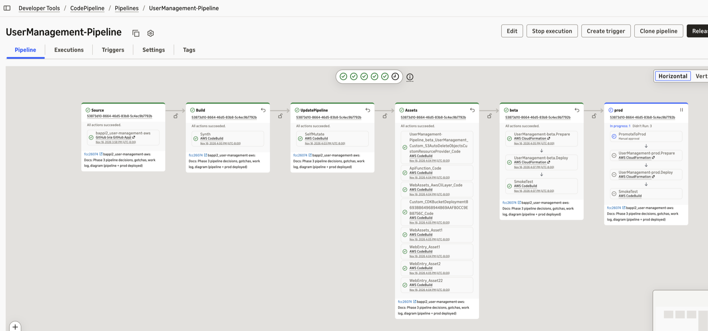

# user-management-aws

I'm learning React, AWS CDK, Java Lambda and DynamoDB. Explain what you do, go step by step.
Claude does not modify code: Claude explains, I make the changes myself.

## Stack
- infra/: AWS CDK (TypeScript). One app: stack UserManagement-Pipeline, which deploys stages beta and prod
  (stacks UserManagement-beta, UserManagement-prod)
- services/user-api/: Java Lambda (Maven, compile with release 21; local JDK is 27)
- apps/web/: React 19 + Vite + TypeScript SPA, Amplify auth library (hosted on S3 + CloudFront)
- docs/: architecture diagram + work log (no platform/ folder: the pipeline must be in the same CDK app as its stages)

## Architecture

Source: [docs/architecture.svg](docs/architecture.svg). Everything shown is deployed (Phases 1–3).
History of what was built: [docs/WORKLOG.md](docs/WORKLOG.md).

Pipeline in the console (reference, Nov 2026): Source → Build (Synth) → UpdatePipeline (SelfMutate) → Assets (7 actions)
→ beta (Prepare, Deploy, SmokeTest) → prod (PromoteToProd approval, Prepare, Deploy, SmokeTest).

## Decisions
- Build order: infra → backend → frontend
- One AWS account for now (456423665721, us-west-2): pipeline, beta and prod all live there (decided in 3.0:
  multi-account is overkill while learning). Later path: AWS Organizations + prod account, `cdk bootstrap --trust`,
  `crossAccountKeys: true`, per-stage accounts in environments.ts
- AWS account comes from env var USER_MGMT_ACCOUNT (set in ~/.zshrc; validated as 12 digits in environments.ts).
  The pipeline passes it to CodeBuild (`env: { USER_MGMT_ACCOUNT: this.account }`)
- Config pattern: infra/config/types.ts + environments.ts (stage, env, retainData, pointInTimeRecovery, lambda, api, web.allowedOrigins)
- DynamoDB single-table design: table `usermanagement-${stage}`, keys pk/sk, GSI1 (gsi1pk/gsi1sk), PAY_PER_REQUEST
- No VPC (DynamoDB is reached over IAM + HTTPS)
- Everything destroyable while learning (RemovalPolicy.DESTROY, retainData false)
- Tags: Project, Developer, ManagedBy, Stage
- API design follows my Evently project (bappi2/evently7, Users module), adapted for Cognito:
  - Registration = Cognito SignUp + ConfirmSignUp (email code); NO /v1/users/register (removed in 1.5b)
  - GET/PUT /v1/users/profile behind Cognito authorizer (ID token in `Authorization`); userId = claims.sub
  - One Lambda, router → one handler per use case; errors as RFC 7807 Problem Details
- REST API (apigateway.RestApi), proxy integration, stage name = config.stage, throttling from config
- Request validation: API Gateway models for shape (rejects at the edge, no Lambda cost) + Java validation
  for rules (authoritative, per-field errors). Gateway 400s use Problem Details (BAD_REQUEST_BODY gateway response)
- Java Lambda: plain Java (no framework), mirrors Evently file names (GetUserProfile, UpdateUserProfile,
  Endpoint ≈ IEndpoint, UserRepository ≈ IUserRepository); errors via ApiException → Problem Details
- Same JAR, two handlers: ApiHandler (API Gateway) and users.PostConfirmationHandler (Cognito trigger,
  ≈ Evently RegisterUserCommandHandler); shared CDK `javaFunctionProps`
- DynamoDB items: `USER#/PROFILE` only. Written by PostConfirmation via PutItem + attribute_not_exists
  (idempotent on Cognito retries); only for triggerSource PostConfirmation_ConfirmSignUp (not ConfirmForgotPassword).
  Email uniqueness owned by Cognito (EMAIL# reservation item removed). Update via conditional UpdateItem; consistent reads
- Cognito: email sign-in, case-insensitive, required given_name/family_name (immutable after pool creation!),
  password policy 8+ upper/lower/digit, EMAIL_ONLY recovery, self sign-up with email code (default sender ~50/day).
  App client: no secret, SRP + USER_PASSWORD (password flow only for CLI testing), preventUserExistenceErrors, 1h tokens
- Google sign-in (4.2c): Cognito domain `https://<config.auth.domainPrefix>.auth.us-west-2.amazoncognito.com`
  (classic hosted UI, never shown: `identity_provider=Google` goes straight to Google). One Google Cloud project
  `user-management` + one Web OAuth client for beta AND prod (redirect URIs = both Cognito domains + `/oauth2/idpresponse`;
  consent screen External, Testing mode, test users only). Client ID in environments.ts (public); client secret in
  SSM Parameter Store String `/usermanagement/google-client-secret` (free; created by hand; CDK uses
  `{{resolve:ssm:…}}` so it's never in git/cdk.out; ssm-secure isn't allowed for this property; Cognito returns it via
  DescribeIdentityProvider anyway, so Secrets Manager adds little here). IdP scopes openid/email/profile, mapping
  email, email_verified, given_name, family_name. App client: COGNITO + Google, code flow only (no implicit), scopes
  openid/email/profile/aws.cognito.signin.user.admin (self-service APIs like deleteUser for Google users),
  callback `<origin>/auth/callback`, logout `<origin>/login` for every allowedOrigin (localhost only on beta).
  Client defined after the distribution (needs the CloudFront URL) + `addDependency(googleProvider)`.
  config.json carries `oauthDomain` (no https://)
- Trigger: SnapStart + alias + read-only priming; timeout 5s (Cognito limit). Admin-created users don't fire it
- IAM narrowed: API fn GetItem+UpdateItem; trigger fn PutItem+GetItem
- Authorizer errors: missing token → 401 (UNAUTHORIZED), invalid token → 403 (ACCESS_DENIED); both Problem Details.
  Frontend must treat 401 and 403 from /profile as "sign in again". Exception (4.3): 403 with title `Tier.Required`
  comes from Java (valid user, tier too low) → show upgrade prompt, not sign-in
- Tiers (4.3): enum `Tier` FREE < PRO (declaration order = rank via `includes`; add BUSINESS etc. at the end when
  needed). Stored as the name on USER#/PROFILE `tier`; missing/unknown → FREE (fail closed, no migration).
  PostConfirmation writes FREE. Read from DynamoDB on every gated call (not from the token: upgrades apply on the next
  request). `TierCheck.require(user, Tier.PRO)` → 403 Problem Details `Tier.Required`. API Gateway only checks
  identity; Java checks the tier. Users can't change their tier (no API); today: `aws dynamodb update-item` by hand
- Tutorial (4.3d): `tutorialVersion` number on PROFILE (not written at insert: missing = 0; insert Map.of is at its
  10-pair max). GET /me returns it; PUT /v1/users/me/tutorial `{"version": n}` (model: integer ≥ 1; Java `atLeast`)
  → 204. One conditional UpdateItem `attribute_exists(pk) AND (attribute_not_exists(tutorialVersion) OR
  tutorialVersion < :v)` (atomic, no read-compare-write race) + `ReturnValuesOnConditionCheckFailure.ALL_OLD`:
  old item present → lower/equal = no-op 204; no item → 404
- GOTCHA: removing a REST API route via CDK can leave it live in the stage (Deployment snapshot is taken before
  CFN cleanup deletes the old Method). After removing routes, verify the stage with
  `aws apigateway get-export --stage-name <stage> --export-type oas30` and `create-deployment` if needed
- GOTCHA: API Gateway request models are per Content-Type; a non-JSON content type skips body validation.
  Java validation stays authoritative
- Lambda runtime: Java 21 on arm64, 1024 MB, low-level DynamoDB client + url-connection-client, SDK timeouts 3s/1s,
  JSON log format with levels, JAVA_TOOL_OPTIONS tiered compilation (level 1)
- SnapStart on published versions; API Gateway calls alias `live`; priming via CRaC beforeCheckpoint must be
  READ-ONLY (runs once per snapshot, possibly several times)
- Build before synth (order matters): `npm run build` in apps/web → `mvn package` in services/user-api →
  `cdk synth/diff` in infra. CDK synth fails if dist/index.html or the JAR is missing. Chain with `&&`.
  The pipeline's Synth step runs exactly this; locally it's only needed for `cdk diff`
- Pipeline (CDK Pipelines, infra/lib/pipeline-stack.ts, config in infra/config/pipeline.ts):
  - Source: GitHub bappi2/user-management-aws `main` via CodeConnections (GitHub App, no token in AWS)
  - Synth: CodeBuild STANDARD_7_0, runtime-versions nodejs 22 + corretto21; subshell commands
    `(cd apps/web && npm ci && npm run build)`, `(cd services/user-api && mvn -B package)` (13 tests gate the deploy),
    `(cd infra && npm ci && npx cdk synth)`; primaryOutputDirectory infra/cdk.out
  - Pipeline type V2, crossAccountKeys false (one account, no KMS key), self-mutating (UpdatePipeline stage)
  - Stages: beta (post: SmokeTest) → prod (pre: ManualApprovalStep PromoteToProd, post: SmokeTest)
  - SmokeTest (shared `smokeTest(stage)` function): WebUrl 200, /config.json 200, profile without token 401,
    CORS preflight from WebUrl 204. URLs via `envFromCfnOutputs` (stack exposes `webUrl`/`apiUrl` CfnOutputs)
  - `UserManagementStage` (cdk.Stage) wraps the stack + tags; keeps `stackName: UserManagement-${stage}`
  - Deploy from the laptop ONLY for the pipeline stack itself (`npx cdk deploy UserManagement-Pipeline`), and only
    after pushing (first run pulls main). Everything else: `git push`. Approve prod in the console
- GOTCHA: changing the construct path (stack → Stage → pipeline) changes path-derived names: Lambda::Permission IDs,
  API Deployment hash, CloudFront origin Id, BucketDeployment `aws-cdk:cr-owned` tags. Harmless (no stateful
  resource replaced). Rule for `cdk diff`: red flag only if table / user pool / bucket / distribution is replaced
- GOTCHA: a push that changes the pipeline itself shows a "Cancelled" execution: SelfMutate updates the pipeline,
  cancels the old run and restarts on the same commit. App-only changes run straight through
- GOTCHA: `envFromCfnOutputs` needs the `CfnOutput` object, so the stack must keep it in a public field
  (`this.webUrl = new CfnOutput(...)`); same construct ID = no template change
- GOTCHA: CORS preflight returns 204 even for a disallowed origin; API Gateway answers with
  `Access-Control-Allow-Origin` set to an allowed origin and the BROWSER blocks the mismatch. Check the header, not the status
  (prod allows only its CloudFront URL, so localhost can't call the prod API)
- Frontend:
  - Amplify auth library only (no Amplify CLI/backend/hosting): signUp, confirmSignUp, signIn (SRP), signOut,
    resetPassword + confirmResetPassword (forgot password), signInWithRedirect({ provider: 'Google' }),
    fetchAuthSession (auto-refreshes tokens). Tokens stored in localStorage (Amplify default)
  - Google redirect sign-in (4.2c5): auth.ts adds `loginWith.oauth` (domain = config.oauthDomain, scopes = the client's,
    redirectSignIn `${window.location.origin}/auth/callback`, redirectSignOut `${origin}/login`, code) + imports
    `aws-amplify/auth/enable-oauth-listener`. On configure Amplify exchanges `?code=` itself (PKCE), strips it from the
    URL, fires Hub `signInWithRedirect` + `signedIn`; getCurrentUser() waits meanwhile (status stays `loading`).
    AuthCallbackPage (`/auth/callback`, in AuthLayout but outside GuestOnly): loading → "Signing you in…",
    signedIn → `/app`, `?error`/signedOut → "Sign-in failed". signOut for Google users redirects via Cognito
    `/logout` → `/login` (clears the Cognito session cookie; the in-memory signOutMessage is lost on that reload);
    password users: no redirect
  - Routing (4.1): React Router v8, declarative mode (`BrowserRouter` + `Routes`; v8 has no react-router-dom, import
    from `react-router`). App.tsx = route table only. Three layout routes: PublicLayout (`/`, `/privacy`, 404),
    AuthLayout (`/auth/callback`; `/login`, `/signup`, `/confirm?email=`, `/forgot-password`, `/reset-password?email=` inside GuestOnly),
    AppLayout sidebar (`/app`, `/app/profile` inside RequireAuth). Pages that need `?email=` redirect with
    `<Navigate replace>` when it's missing
  - Auth card (4.2b): AuthLayout = grey page + centred card. Login/signup pages show AuthTabs (NavLinks with `replace`,
    so the tab is the URL) + SocialButtons (Google button → signInWithRedirect) + "or" divider; confirm/forgot/reset
    pages show only their form. Forgot/reset UI says "If an account exists…" (preventUserExistenceErrors)
  - Auth state: AuthProvider (src/auth) sets `status` (loading | signedIn | signedOut) from Amplify Hub `signedIn` /
    `signedOut` events + one getCurrentUser() at startup; nobody sets it by hand. `useAuth()` exposes
    `{ status, signOutMessage, signOut(message?) }`; RequireAuth passes `from` (redirect-back) + the message to /login
  - Convention: `components/` = reusable forms reporting events via callback props (SignInForm, ProfileForm…);
    `pages/` = one file per URL wiring them to router/context. App name in `src/brand.ts` (APP_NAME) + index.html title
  - api.ts = single API client: ID token in `Authorization`, ApiError(status, problem), 401/403 → ProfilePage calls
    `signOut('Your session expired…')`
  - GOTCHA: `npm run dev` does NOT type-check: a missing import is a blank page (ReferenceError in the Console).
    Run `npx tsc -b` when the page is blank. Router hooks throw outside `<BrowserRouter>`
  - Config: `config.ts` loadConfig() → dev uses .env.local (scripts/env-from-stack.sh, VITE_* vars incl.
    VITE_OAUTH_DOMAIN from output AuthDomainUrl without https://; rerun the script after adding a value);
    hosted build fetches /config.json written by CDK (s3deploy Source.jsonData, deploy-time tokens). Same dist/ for every stage
- CORS: allowed origins = config.web.allowedOrigins (beta: http://localhost:5173) + CloudFront URL (token).
  Three sources: RestApi defaultCorsPreflightOptions (OPTIONS), Java ApiHandler.withCors (echoes allowed Origin + Vary),
  gateway responses (Unauthorized/AccessDenied/BadRequestBody/DEFAULT_4XX/DEFAULT_5XX) with `Access-Control-Allow-Origin: *`
- Hosting: private S3 bucket (BLOCK_ALL, enforceSSL, autoDeleteObjects) + CloudFront with Origin Access Control,
  HTTPS redirect, PRICE_CLASS_100, SPA fallback (403/404 → /index.html). Cache: hashed assets
  `public, max-age=31536000, immutable`; index.html + config.json `no-cache` + invalidated on deploy (two BucketDeployments, prune false)
- Security headers (ResponseHeadersPolicy): HSTS 1y, CSP `default-src 'self'; script-src 'self'; style-src 'self';
  connect-src 'self' https://*.amazonaws.com https://*.amazoncognito.com; frame-ancestors 'none'`, X-Frame-Options DENY,
  nosniff, referrer policy. amazoncognito.com is for Amplify's fetch to `/oauth2/token`; redirects to Cognito/Google
  are navigations, not covered by connect-src. CSP only exists on CloudFront (dev server has none)
- Hardening backlog: BEFORE REAL USERS: account linking (decided 4.2c6: deferred). Today the same email via password
  and via Google = two Cognito users, two subs, two profiles/tiers. Plan: PreSignUp trigger (Java); on
  PreSignUp_ExternalProvider, if a CONFIRMED native user has that email and Google says email_verified → 
  AdminLinkProviderForUser (Google becomes a second login for the same sub); on PreSignUp_SignUp, reject if a
  federated user owns the email. IAM via a hand-built pool ARN (grant on userPool.userPoolArn = circular dependency).
  Known quirk: the first linked sign-in fails once ("Already found an entry"), retry works.
  HIGH: stop using the root user (MFA on root, IAM Identity Center admin for console/CLI/approvals;
  prod was approved as root in 3.5); pipeline notifications (SNS/chatbot on approval waiting + failure);
  CodeBuild cache for npm/Maven; self-service account deletion (privacy page promises deletion on request); pipeline trigger file-path filter (skip docs-only pushes: `docs/**`, `*.md`); smoke test: route check via `get-export` + real sign-in (test user);
  Powertools (logging, metrics, tracing, idempotency); DynamoDB Local/Testcontainers tests;
  CodeDeploy canary on alias; disable USER_PASSWORD_AUTH in prod; SES for Cognito email; $default model or reject
  non-JSON content types; sync profile email when Cognito email changes;
  tokens in cookies (Amplify CookieStorage) instead of localStorage; update typescript-eslint when minimatch fix ships;
  custom domain + ACM (optional 2.6); multi-region DynamoDB later (TableV2 replicas; Lambda/API/Cognito are regional);
  Google client secret → Secrets Manager once there's a team / separate prod account; reproducible JAR
  (`project.build.outputTimestamp`: today every build changes the JAR hash → new Lambda versions on every deploy);
  publish Google consent screen (needs a verifiable domain for the privacy URL, i.e. custom domain)
- Prod readiness (before real users): retainData true, PITR on, table deletionProtection, separate account
  (deploy via pipeline: done in 3.5)

## Done
- 1.2: CDK app, stage config, DynamoDB table (deployed, tested, destroyed)
- 1.3: Placeholder Node Lambda (infra/lambda/placeholder) + REST API routes (deployed, tested, destroyed)
- 1.3b: Request validator + models for register / profile PUT, Problem Details gateway response (deployed, tested, destroyed)
- 1.4: Java Lambda in services/user-api (router, 3 endpoints, DynamoDbUserRepository, 8 JUnit tests); placeholder removed;
  arm64 + SnapStart + priming. Cold start: client 4.4s → 3.0s, billed 3.45s → 1.8s (deployed, tested, destroyed)

- 1.5a: Cognito User Pool + app client + Cognito authorizer on /profile; tested with real ID token (deployed, tested)
- 1.5b: Option B: Cognito SignUp + PostConfirmation trigger writes USER#; RegisterUser + /register removed;
  IAM narrowed; 11 JUnit tests; real end-to-end flow (sign-up → code → confirm → sign-in → GET/PUT profile) (deployed, tested, destroyed)

- 2.1: Vite + React + TypeScript app shell in apps/web (ESLint)
- 2.2: CORS (preflight, Lambda origin echo, gateway responses) + frontend config from stack outputs; 13 JUnit tests
- 2.3: Amplify auth: sign up, confirm code, sign in (SRP, password never sent), sign out, session survives reload
- 2.4: Profile page: GET/PUT /v1/users/profile with ID token, gateway vs Java validation errors, session-expired handling
- 2.5: S3 + CloudFront hosting (OAC, security headers, cache rules, SPA fallback) + runtime config.json.
  Live at the stack's WebUrl output

- 3.0: Decided: one account for now (two-account layout drafted, then dropped)
- 3.1: GitHub connection (CodeConnections, AVAILABLE)
- 3.2: UserManagementStage wraps the stack (stackName kept; path-churn diff reviewed, deployed, smoke-checked)
- 3.3: Pipeline stack (Source, Synth with React + Java + CDK, self-mutation, beta stage); deployed once from laptop
- 3.4: Beta SmokeTest via envFromCfnOutputs (added by git push → self-mutation)
- 3.5: Manual approval + prod stage + prod SmokeTest. Prod live (UserManagement-prod, its own pool/table/CloudFront URL)
- 3.7: Prod sign-up + profile save verified; failing JUnit test stopped the pipeline at Synth (beta/prod untouched,
  checked via LastUpdatedTime); `git revert` → green through beta and prod

- 4.1: React Router (a–d on `feature/4.1-router`): routes, AuthContext from Hub events + guards, sidebar app layout,
  public landing / privacy / 404 pages. Deployed beta + prod; deep links work via the CloudFront SPA fallback
- 4.2a: Forgot password (`/forgot-password` → email code → `/reset-password?email=`). Deployed beta + prod, tested on beta
- 4.2b: Auth card (Sign in / Create account tabs, Google button placeholder, "or" divider). Deployed beta + prod
- 4.2c1: Cognito domains usermanagement-beta / usermanagement-prod (ACTIVE, deployed)
- 4.2c2: Google Cloud project + OAuth client (both Cognito redirect URIs), consent screen in Testing
- 4.2c3: Client secret in SSM Parameter Store (free) instead of Secrets Manager
- 4.2c4: Google IdP + app client OAuth (code flow, callbacks, scopes) + CSP amazoncognito.com; diff reviewed
  (client updated in place, secret absent from cdk.out). Deployed beta + prod. Backend-only test via the raw
  `/oauth2/authorize` URL: user `google_<id>` (EXTERNAL_PROVIDER, email_verified true, names mapped) and
  PostConfirmation fired on first federated sign-in → `USER#/PROFILE` written, no Java change needed
- 4.2c5: React: Amplify oauth config, Google button (signInWithRedirect), `/auth/callback` page. Tested locally:
  Google → /app, claims, profile GET/PUT, sign out via Cognito /logout, same sub on re-sign-in, password users unchanged.
  Deployed beta (hosted Google sign-in incl. CSP token fetch) + prod
- 4.2c6: account linking deferred (backlog, before real users)
- 4.3a–c: Tier enum (FREE, PRO) + `tier` on PROFILE, GET /v1/users/me, TierCheck → 403 `Tier.Required`, demo
  GET /v1/demo/pro, CDK routes (Cognito authorizer, no model); 19 JUnit tests; diff reviewed (additions only).
  Deployed beta + prod. Beta test: old user /me → FREE (no tier attribute), /demo/pro 403 → update-item PRO →
  same token 200 (bappi2+umtest2 stays PRO for 4.4)
- 4.3d: tutorialVersion on User, GET /me field, PUT /v1/users/me/tutorial (upward-only conditional update, model);
  22 JUnit tests; diff reviewed (additions only)

## Phase 4 plan (reusable starter for a future app)
Public landing page, social login, user tiers, sidebar for signed-in pages.
- 4.1: React Router; public `/`, `/login`, `/signup`, `/privacy`; protected `/app/*` layout with sidebar (frontend only)
- 4.2: a) forgot password, b) auth card, c) Google sign-in via Cognito federation: c1 Cognito domain (CDK) →
  c2 Google Cloud OAuth client + consent screen (redirect `https://<prefix>.auth.us-west-2.amazoncognito.com/oauth2/idpresponse`)
  → c3 client secret in SSM Parameter Store String (free) → c4 IdP + attribute mapping + app client OAuth callbacks
  (localhost, beta, prod) + CSP connect-src
  `https://*.amazoncognito.com` → c5 Amplify oauth config + signInWithRedirect → c6 account linking: deferred to
  the backlog (PostConfirmation for Google users verified in c4)
- 4.3: Tiers FREE < PRO for now (BUSINESS later = one enum line; enum order = rank; stored uppercase;
  missing/unknown → FREE = fail closed): `tier` on USER#/PROFILE (set by PostConfirmation), GET /v1/users/me,
  Java tier checks → 403 (DynamoDB, not Cognito groups: a payment webhook can change it instantly). Users can't
  change their tier. a) model b) /me + TierCheck + demo GET /v1/demo/pro c) CDK routes + deploy.
  d) Tutorial progress: `tutorialVersion` number on PROFILE (missing = 0), returned by /me, raised by the user via
  PUT /v1/users/me/tutorial `{"version": n}` (conditional: only upwards). Frontend shows the tutorial when
  stored < CURRENT_TUTORIAL_VERSION → a new tutorial version shows once to everyone, no migration
- 4.4: Tier-gated pages (locked sidebar items, upgrade prompt), tutorial overlay + "Replay tutorial", optional usage
  quotas per tier with rolling windows (used/limit/resetAt; conditional UpdateItem)
- Later (Stripe): billing state separate from tier (subscriptionStatus, stripeCustomerId, currentPeriodEnd,
  cancelAtPeriodEnd); tier changes only via webhook
- Later: custom domain, Stripe. Optional/paid: Apple sign-in (needs the $99/year Apple Developer Program; skipped
  for budget. Name only sent on first sign-in; pool requires given/family name)

## Current step
4.3d on branch `feature/4.3d-tutorial`: merge + deploy beta, test with curl (/me → 0, PUT 2 → 204, PUT 1 → 204,
/me → 2, PUT 0 → 400 from the gateway model, PUT 2.5 → 400), approve prod. Then 4.4 (frontend: /me in context,
tier-gated sidebar + upgrade prompt, 403 `Tier.Required` vs sign-in, tutorial overlay + "Replay tutorial").
Workflow: `feature/*` branches; merge to `main` = deploy; put doc updates on the branch (one pipeline run).
